<!-- generated by tools/readme/build.mjs from tools/readme/body.md. do not edit by hand. -->
# SecureWall

<picture>
<source media="(max-width: 500px) and (prefers-color-scheme: dark)" srcset="docs/readme/hero-narrow-dark.svg">
<source media="(max-width: 500px)" srcset="docs/readme/hero-narrow-light.svg">
<source media="(prefers-color-scheme: dark)" srcset="docs/readme/hero-dark.svg">

</picture>

SecureWall is a default-deny firewall for Windows 10 and 11, built on TinyWall. Nothing on the PC reaches the network until a rule allows it. When an app you have not decided on tries to connect out, SecureWall blocks it and asks you in a small window at the bottom right of the screen.

[secwall.org](https://secwall.org/) · [Latest release](https://github.com/ryanportfolio/SecureWall/releases) · [Install guide](docs/INSTALL.md) · [Security model](docs/SECURITY.md)

> [!WARNING]
> SecureWall is alpha software, and every release so far is an unsigned prerelease. Install it only on a PC you can recover at its own keyboard and screen: a firewall defect can cut off networking or weaken host isolation.

## Install

Download the installer for your PC from the [latest release](https://github.com/ryanportfolio/SecureWall/releases):

| Installer | For |
|---|---|
| `SecureWall_x64.msi` | Intel and AMD 64-bit PCs (most PCs) |
| `SecureWall_arm64.msi` | Windows on ARM |
| `SecureWall_x86.msi` | 32-bit Windows only |

Alpha installers are unsigned, so Windows shows an unknown-publisher warning. Before running one, check it against the release's `SHA256SUMS.txt`: paste the file's line from that list into the command below (use your installer's name). It prints `True` when they match.

```powershell
(Get-FileHash .\SecureWall_x64.msi -Algorithm SHA256).Hash -eq '<hash from SHA256SUMS.txt>'
```

Setup refuses to run while TinyWall is installed. To upgrade from v0.5.0 or later, run the newer MSI at the PC's own keyboard and screen; v0.5.2 and later can also fetch and run it from **Check for updates** in the tray menu. Rules, settings and the password are kept, and connections to other computers stay blocked for the minute or so the swap takes. v0.4.2 and older must be uninstalled first.

[docs/INSTALL.md](docs/INSTALL.md) covers upgrades, update checks, what stays blocked while the service is down, setup logs, moving from TinyWall, and recovery.

## When an app is blocked

Normal mode blocks inbound and outbound traffic unless a rule allows it. Only outbound connections stopped by SecureWall's default-block filters raise a prompt. The popup offers:

- **Allow outgoing**: a permanent rule that lets this app, package or service reach any destination and port over TCP and UDP. The destination shown in the popup does not limit the rule.
- **Always allow**, for programs with a valid embedded signature on a local drive: the same rule, plus one that allows any file with this name signed by the same publisher, in any folder.
- **Ignore**: keep blocking and stop asking. The app goes on the Ignored list under Manage, which adds no filter and lets no traffic through.
- Closing the popup keeps the app blocked, adds no rule, and pauses prompts for that app for five minutes. A prompt that expires unanswered is listed under **Blocked apps not answered** in the tray menu.

Explicit user blocks, blocklists, inbound drops and shared service hosts that SecureWall cannot pin to one exact service never become allow rules. A service with no service SID, or a program SecureWall cannot rule out as a service, gets a prompt with Allow disabled and the reason. While SecureWall is locked with a password, Allow and Always allow ask for it first, and so does Ignore when it has an entry to save; cancelling Ignore's password only pauses prompts for that app for five minutes. [docs/SECURITY.md](docs/SECURITY.md) explains each case, including what Always allow trusts.

TinyWall's Learning (Autolearn) mode is removed and the prompts replace it. A saved or imported configuration that names Learning starts in Normal mode; exceptions learned by earlier builds stay until you delete them.

The AI **?** lookup in the popup is off by default. Turning it on (SecureWall must be unlocked) lets `SecureWall.exe`, in Normal mode, make outbound TCP connections to port 443 on any host, not only the AI provider, from signed-in accounts only and never as the LocalSystem service. Other ports, and a system proxy on another port, are not supported. Each lookup sends the provider the executable's file name, its unverified publisher and its identity type (plus service name or package SID when present), never the full path; the destination is sent only if you opt in. Answers are labelled AI-generated, capped in size, and never change policy. Do not add your own exception for `SecureWall.exe`: it would cover the service too.

## Network Activity

**Network Activity** in the tray menu refreshes every second. It lists the connections WFP allowed or blocked, with the reason for a block where SecureWall knows it, the state of each TCP connection, and local listening endpoints. `Listening (local endpoint)` means a program has the port open; it does not claim the port is reachable from outside.

## Build and test

SecureWall targets .NET Framework 4.8. Build it with Visual Studio Build Tools' MSBuild, not `dotnet build`, because the project uses COM references. Run the dependency-free security tests, restore packages, then build:

```powershell
dotnet run --project tests\SecureWall.Core.Tests\SecureWall.Core.Tests.csproj
dotnet restore TinyWall\TinyWall.csproj
& "${env:ProgramFiles(x86)}\Microsoft Visual Studio\2022\BuildTools\MSBuild\Current\Bin\MSBuild.exe" TinyWall\TinyWall.csproj /t:Build /p:Configuration=Debug /p:RestorePackages=false
```

Debug builds add `/protocolselftest`, `/pipeintegrationtest` and `/promptpreview`, which check IPC serialization, the authenticated pipe and the popup without starting the service or touching WFP. `tools\release\Build-SecureWallRelease.ps1` builds the three MSIs and their SHA-256 manifest with WiX 3.14.1 and installs nothing. Real firewall behavior counts as verified only after the VM matrix in [docs/TESTING.md](docs/TESTING.md) runs on an expendable Windows VM.

## Documentation

- [docs/INSTALL.md](docs/INSTALL.md): Installers, upgrades, update checks, logs and recovery
- [docs/SECURITY.md](docs/SECURITY.md): Threat model, prompt rules, service and WFP behavior, recovery rules
- [docs/TESTING.md](docs/TESTING.md): Build and test commands, the privileged VM matrix
- [docs/HARDENING-VALIDATION.md](docs/HARDENING-VALIDATION.md): Reboot, audit-policy and WFP hardening checks
- [tools/vm/README.md](tools/vm/README.md): Running the real-firewall validation on an expendable Windows VM
- [docs/LIVE-TESTING.md](docs/LIVE-TESTING.md): Trying SecureWall in daily use, and rolling back to TinyWall
- [docs/DIAGNOSTIC-COVERAGE.md](docs/DIAGNOSTIC-COVERAGE.md): What the diagnostic logs record and what they cannot show
- [tools/diagnostics/README.md](tools/diagnostics/README.md): Local support-bundle collector
- [docs/releases/](docs/releases/): Release notes for every version
- [UPSTREAM.md](UPSTREAM.md): TinyWall provenance and every change made to it

## Lineage and license

SecureWall is based on TinyWall 3.5.1, pinned to upstream commit `1df71b146d01d734d5b5a45a814b29e6a073f4d0`. It is not TinyWall and is not endorsed by TinyWall's author.

The firewall application and this combined work are licensed under the GNU GPL version 3; see [LICENSE](LICENSE). Starter automation in `.claude/`, `.agents/` and `.codex/` keeps its own terms in [LICENSES/STARTER-MIT.txt](LICENSES/STARTER-MIT.txt) and any per-skill notices.
